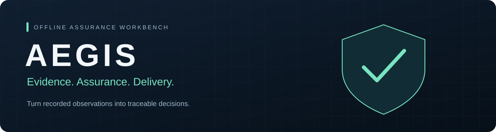

<p align="center">
  
</p>

<p align="center">
  <a href="https://github.com/Austin610/AEGIS/actions/workflows/ci.yml"></a>
  
  
  
</p>

<p align="center">
  <strong>A local workspace for evidence, findings, regression checks, and Scrum delivery.</strong><br>
  Import recorded results, compare baselines, track remediation, and keep decisions auditable.
</p>

<p align="center">
  <a href="#quick-start">Quick start</a> ·
  <a href="#what-you-can-do">Features</a> ·
  <a href="#project-status">Project status</a> ·
  <a href="#documentation">Documentation</a>
</p>

---

## What you can do

| Evidence & assurance | Planning & delivery |
| --- | --- |
| Import SARIF, JUnit, JSON observations, and metrics | Organize stories, tasks, subtasks, and bugs |
| Compare named baselines and evaluate regression gates | Plan sprints with points, capacity, and assignees |
| Triage findings and link remediation to retest evidence | Track acceptance criteria and Definition of Done |
| Inspect provenance, coverage, and stakeholder reports | Follow the sprint board, burndown, reviews, and retrospectives |

**Built around traceability.** Scoped reader, analyst, and administrator access;
revocable credentials; durable offline jobs; audit history; SQLite or PostgreSQL
storage; and verified backup/restore workflows.

**Scope:** AEGIS evaluates user-supplied observations and imported results. It does
not perform live target scanning, vulnerability reproduction, or exploit execution.

## Quick start

Requires **Python 3.12+** and Git. Run these commands in PowerShell:

```powershell
git clone https://github.com/Austin610/AEGIS.git
cd AEGIS
python -m venv .venv
.\.venv\Scripts\python.exe -m pip install -e .
.\scripts\start-local.ps1
```

Open **[localhost:8766](http://127.0.0.1:8766)**. Sign in with the owner token stored
in `.aegis/app/access-token`; keep this file private. Data and credentials persist
across restarts. Browser sessions require signing in again after a restart.

<details>
<summary><strong>Linux / macOS</strong></summary>

```bash
git clone https://github.com/Austin610/AEGIS.git
cd AEGIS
python3 -m venv .venv
.venv/bin/python -m pip install -e .
AEGIS_DURABLE_JOBS=1 .venv/bin/aegis serve --data-dir .aegis/app --port 8766
```

</details>

### Your first workspace

1. Choose **Load synthetic example** to explore three labeled runs: PASS → FAIL → PASS.
2. Create a workspace and define a time-bounded scope with exact `fixture://` targets.
3. Import recorded evidence, inspect findings, and compare a run against a baseline.
4. Open **Backlogs & sprints** to plan work, or **Build & readiness** to review release checkpoints.

## Offline workflows

| Workflow | What it produces |
| --- | --- |
| JSON invariants | Declarative comparisons with explicit unknown/error outcomes |
| SARIF import | Analyzer findings, locations, suppressions, and provenance |
| Analyst notebook | Sanitized recorded observations |
| OpenAPI inventory | Operations and declared security metadata |
| File metadata | Hash, size, and format hints without executing the file |
| Research evaluation | Precision, recall, F1, coverage, and unknown counts |
| JUnit import | Recorded test outcomes with provenance |
| Declared invariants | Expected versus supplied observed outcomes |
| Metric thresholds | Minimum and maximum checks over supplied metrics |

All nine modes include a notebook workflow. Specialized adapters are available by
mode; a mode's presence does not mean its full blueprint is implemented.

## Project status

**12 of 14 release checkpoints verified.** This is acceptance progress for the
current defensive offline release, not a percentage of the full M0–M14 blueprint.

| Area | Status |
| --- | --- |
| Local platform, evidence workflows, and Scrum | Verified |
| Durable jobs, data lifecycle, and recovery | Verified |
| Windows/Linux tests and browser workflows | Passed in GitHub Actions |
| PostgreSQL integration and Docker build/runtime checks | Passed in GitHub Actions |
| Live GitHub OAuth sign-in | Pending local OAuth configuration and live acceptance |
| Production capacity and deployment recovery | Pending deployment-specific qualification |

[Verified CI run](https://github.com/Austin610/AEGIS/actions/runs/35711091857)
· [Detailed progress](docs/progress.json)
· [Roadmap](docs/roadmap.md)
· [Deployment acceptance](docs/deployment-acceptance.md)

Docker verification in CI does not establish that Docker is installed or qualified
on your computer. GitHub sign-in is optional for local use; see the
[setup guide](docs/github-connection.md) and run `aegis check-github` from your
installed environment to check configuration without displaying secrets.

## Development

From the cloned project, with the virtual environment created:

```powershell
.\.venv\Scripts\python.exe -m pip install -c requirements-dev.lock -e '.[dev]'
npm ci --ignore-scripts
npx playwright install chromium
.\scripts\verify.ps1
```

Node.js 24 is used in CI. Verification covers Python tests, the operational drill,
lint, formatting, types, package builds, frontend checks, and browser workflows.
Windows browser tests use installed Chrome by default. See the
[development guide](docs/development.md) for details. `requirements-dev.lock` holds
tested version constraints; it is not a hash-locked cross-platform lockfile.

<details>
<summary><strong>CLI demos and regression gates</strong></summary>

```powershell
.\.venv\Scripts\aegis.exe assurance demo .aegis/my-demo
.\.venv\Scripts\aegis.exe assurance --help
.\.venv\Scripts\aegis.exe assurance gate WORKSPACE_UUID BASELINE RUN_UUID --database .aegis/app/aegis.db
```

The demo creates a new directory and refuses to overwrite an existing one.

| Exit code | Meaning |
| --- | --- |
| `0` | Pass |
| `1` | Blocking regression |
| `2` | Uncertainty or configuration error |

Defaults block new high/critical regressions. `--fail-on-any-violation` blocks all
current failures. Comparisons require compatible inputs. A passing gate means
no blocking recorded regression under the selected policy; it is not proof that
an application is secure.

[Import commands and workflow guide →](docs/offline-workflow.md)

</details>

<details>
<summary><strong>Run with Docker Compose</strong></summary>

With Docker Engine and Compose available:

```bash
docker compose up --build aegis
```

The app uses a non-root container, a persistent data volume, and a loopback-only
host port. Retrieve the owner token locally with
`docker compose exec aegis cat /data/access-token`; keep it private.
SQLite is the default. The optional PostgreSQL profile requires explicit database
credentials and `AEGIS_DATABASE_URL` configuration.

Read the [operations guide](docs/operations.md) before changing storage or enabling
data deletion. Public hosting requires additional deployment work.

</details>

## Documentation

| Guide | Use it for |
| --- | --- |
| [Scrum](docs/scrum.md) | Backlogs, planning, board rules, and sprint ceremonies |
| [Offline workflows](docs/offline-workflow.md) | Imports, comparisons, and gates |
| [Operations](docs/operations.md) | Access, durable workers, storage, and recovery |
| [GitHub connection](docs/github-connection.md) | OAuth configuration and remote CI |
| [Architecture](docs/architecture.md) | System structure and boundaries |
| [Security](docs/security.md) | Trust model and handling sensitive evidence |
| [Development](docs/development.md) | Tooling and verification |
| [Roadmap](docs/roadmap.md) | Blueprint milestones and remaining scope |

---

<p align="center"><sub>Recorded evidence. Explicit scope. Traceable decisions.</sub></p>
